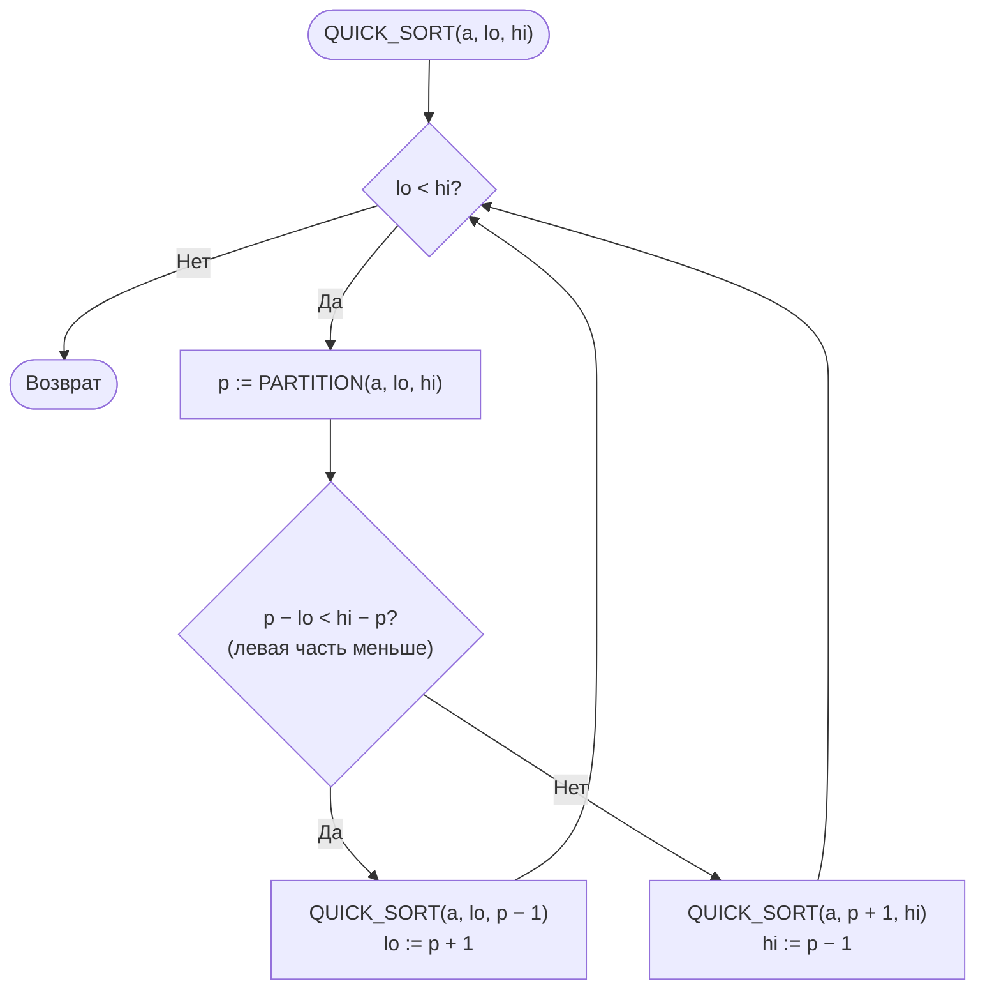
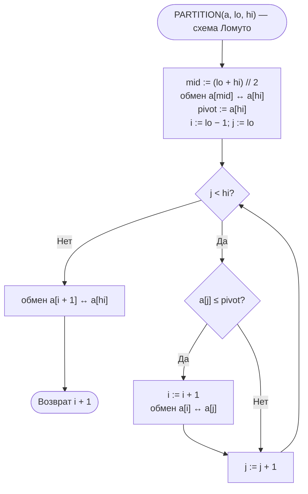
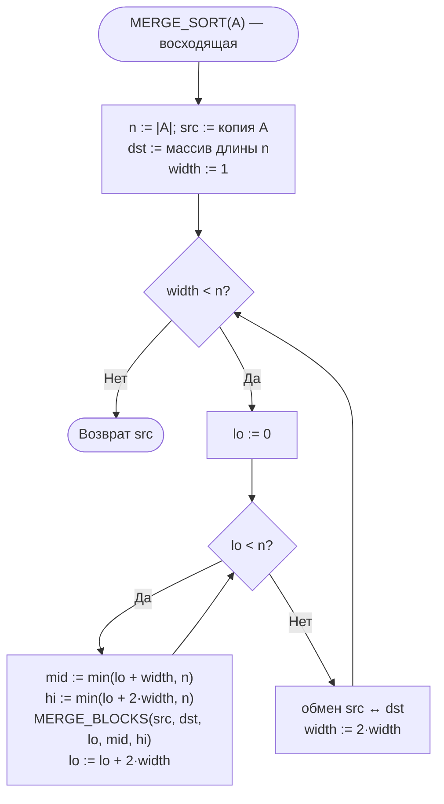
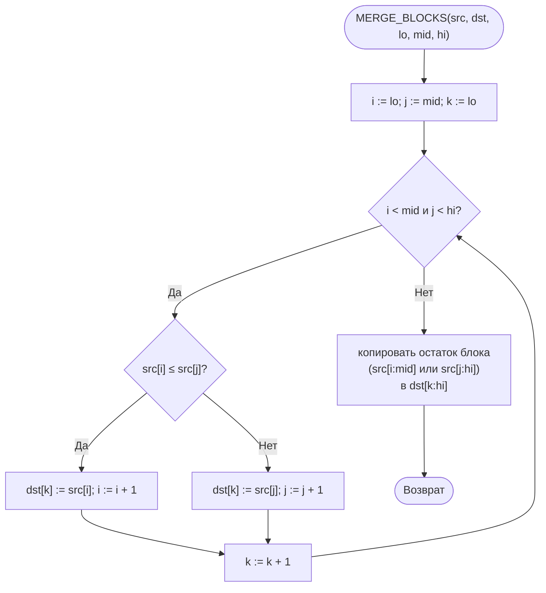

# Лабораторная работа № 3. Вариант 13

**Эмпирический анализ временной сложности алгоритмов сортировки. Часть 2: алгоритмы на основе парадигмы «разделяй и властвуй» (быстрая сортировка и сортировка слиянием)**

| | |
|---|---|
| **Дисциплина** | Теория алгоритмов |
| **Направление** | 38.03.05 «Бизнес-информатика» |
| **Выполнила** | Кугушева Арина Вячеславовна |
| **Группа** | БИ 2-1 |
| **Вариант** | 13 |
| **Язык** | Python 3.10+ (`time`, `random`, `statistics`, `matplotlib`) |

## Файлы работы

| Файл | Назначение |
|---|---|
| [`otchet_lr3_variant13.pdf`](otchet_lr3_variant13.pdf) | Отчёт (титульный лист, теория, блок-схемы, листинг, система, таблицы и графики экспериментов 1–3, сводная таблица, выводы) |
| [`README.md`](README.md) | Описание работы (этот файл) |
| [`lr3_variant13.py`](lr3_variant13.py) | Программа: алгоритмы, эксперименты 1–3, задание Г1, графики |

## Запуск

```bash
pip install matplotlib
python lr3_variant13.py          # график сохраняется в lr3_plot.png
python lr3_variant13.py --show   # дополнительно открыть окно с графиком
```

Файл самодостаточен: функции ЛР № 2 (`bubble_sort`, `insertion_sort`) включены в него, отдельные модули не нужны. Полный прогон занимает около минуты (эксперимент 3 на данных типа D работает несколько секунд из-за квадратичной деградации схемы Ломуто — это ожидаемый результат).

## 1. Задание варианта 13

| Опорный | Разбиение | Слияние | Размеры n для эксперимента 2 | Доп. задание |
|---|---|---|---|---|
| С — средний | Л — Ломуто | В — восходящее (итеративное) | 10 000; 40 000; 70 000; 100 000 | Г1 |

- **Эксперимент 1** — пузырьком, вставками, быстрая, слиянием на размерах варианта 13 ЛР № 2 (n = 1000…5000).
- **Эксперимент 2** — быстрая, слиянием, гибридная быстрая и `sorted()` на больших n (плюс серия с удвоением n для проверки T(2n)/T(n)).
- **Эксперимент 3** — быстрая и слиянием на данных R, S, V, N, D при n = 50 000.
- **Г1** — гибридная быстрая сортировка: подмассивы длиной ≤ M сортируются вставками; M выбирается из {5, 10, 16, 32, 64}.
- Опорный элемент не «первый» и не «последний», поэтому ограничение n ≤ 3000 для упорядоченных данных не требуется.

## 2. Теоретические оценки

| Алгоритм | Лучший | Средний | Худший | Доп. память | Устойчивость |
|---|---|---|---|---|---|
| Пузырьком | Θ(n) | Θ(n²) | Θ(n²) | O(1) | Да |
| Вставками | Θ(n) | Θ(n²) | Θ(n²) | O(1) | Да |
| Слиянием | Θ(n log n) | Θ(n log n) | Θ(n log n) | Θ(n) | Да |
| Быстрая | Θ(n log n) | Θ(n log n) | Θ(n²) | O(log n) | Нет |

- Слияние (восходящее): ⌈log₂ n⌉ проходов по Θ(n) операций → Θ(n log n) во всех случаях.
- Быстрая: T(n) = 2T(n/2) + Θ(n) в среднем; в худшем T(n) = T(n−1) + Θ(n) = Θ(n²). Рекурсия идёт в меньшую часть, глубина стека O(log n).
- Ожидаемое T(2n)/T(n) ≈ 2 + δ (≈ 2,13 при n ≈ 10⁴–10⁵), для квадратичных — 4.

## 3. Блок-схемы

### Быстрая сортировка



### Разбиение Ломуто (средний опорный элемент)



### Сортировка слиянием (восходящая)



### Слияние двух соседних блоков



## 4. Условия эксперимента

Процессор: Intel(R) Xeon(R) Processor @ 2.30GHz (2 логических ядра), ОЗУ 8 ГБ, Linux (Ubuntu 24.04), Python 3.13.18, таймер `time.perf_counter()`, k = 5 повторов, результат — медиана. Абсолютные значения на другом компьютере будут отличаться, соотношения должны сохраниться.

## 5. Результаты

**Таблица 1. Эксперимент 1а — случайные данные, с**

| n | Пузырьком | Вставками | Быстрая | Слиянием |
|---:|---:|---:|---:|---:|
| 1 000 | 0,0262 | 0,0175 | 0,0006 | 0,0008 |
| 2 000 | 0,1055 | 0,0504 | 0,0013 | 0,0018 |
| 3 000 | 0,2402 | 0,1159 | 0,0021 | 0,0028 |
| 4 000 | 0,4497 | 0,2011 | 0,0030 | 0,0038 |
| 5 000 | 0,6836 | 0,3228 | 0,0042 | 0,0050 |

**Таблица 2. Эксперимент 1б — упорядоченные данные (тип S варианта 13 ЛР № 2), мс**

| n | Пузырьком | Вставками | Быстрая | Слиянием |
|---:|---:|---:|---:|---:|
| 1 000 | 0,0349 | 0,0617 | 0,4122 | 0,4953 |
| 2 000 | 0,0600 | 0,1113 | 0,9173 | 1,0979 |
| 3 000 | 0,0986 | 0,1649 | 1,5482 | 1,8015 |
| 4 000 | 0,1441 | 0,2265 | 2,0319 | 2,3923 |
| 5 000 | 0,1687 | 0,3053 | 2,6323 | 3,2035 |

**Таблица 3. Эксперимент 2 — большие массивы (случайные данные), с**

| n | Быстрая | Слиянием | Гибрид (M = 16) | `sorted()` | Слиянием / быстрая |
|---:|---:|---:|---:|---:|---:|
| 10 000 | 0,0087 | 0,0109 | 0,0080 | 0,0010 | 1,25 |
| 40 000 | 0,0395 | 0,0525 | 0,0363 | 0,0049 | 1,33 |
| 70 000 | 0,0740 | 0,0996 | 0,0693 | 0,0095 | 1,35 |
| 100 000 | 0,1138 | 0,1469 | 0,1063 | 0,0151 | 1,29 |

**Таблица 4. Рост T(n₂)/T(n₁) для соседних размеров эксперимента 2**

| Переход | Быстрая | Слиянием | Теория O(n log n) | Теория O(n²) |
|---:|---:|---:|---:|---:|
| 10 000 → 40 000 | 4,52 | 4,80 | ≈ 4,60 | 16,00 |
| 40 000 → 70 000 | 1,87 | 1,90 | ≈ 1,84 | 3,06 |
| 70 000 → 100 000 | 1,54 | 1,47 | ≈ 1,47 | 2,04 |

**Таблица 5. Эксперимент 2б — удвоение n (случайные данные)**

| Переход | Быстрая | Слиянием | Теория O(n log n) |
|---:|---:|---:|---:|
| 12 500 → 25 000 | 2,13 | 2,16 | ≈ 2,15 |
| 25 000 → 50 000 | 2,33 | 2,30 | ≈ 2,14 |
| 50 000 → 100 000 | 2,09 | 2,07 | ≈ 2,13 |

**Таблица 6. Эксперимент 3 — влияние структуры данных (n = 50 000), с**

| Тип данных | Быстрая | Слиянием | Слиянием / быстрая |
|---:|---:|---:|---:|
| Случайные (R) | 0,0521 | 0,0668 | 1,28 |
| Упорядоченные (S) | 0,0350 | 0,0456 | 1,30 |
| Обратно упорядоченные (V) | 0,0390 | 0,0537 | 1,38 |
| Почти упорядоченные (N) | 0,0521 | 0,0632 | 1,21 |
| С повторами (D) | 5,4269 | 0,0539 | 0,01 |

**Таблица 7. Г1 — подбор порога M (n = 100 000, случайные данные, k = 7), с**

| M | 1 (без вставок) | 5 | 10 | 16 | 32 | 64 |
|---:|---:|---:|---:|---:|---:|---:|
| Время, с | 0,1109 | 0,1079 | 0,1072 | 0,1035 | 0,1109 | 0,1337 |

Оптимальное M = **16** (выигрыш ≈ 7 %).

**Таблица 8. Сводная таблица (n = 5000, случайные данные)**

| Алгоритм | Теор. сложность | Время, с | Ускорение относительно пузырька | Эксп. рост T(4000)/T(2000) | Память | Устойчивость |
|---:|---:|---:|---:|---:|---:|---:|
| Пузырьком | Θ(n²) | 0,6836 | 1 | 4,26 | O(1) | Да |
| Вставками | Θ(n²) | 0,3228 | 2,1 | 3,99 | O(1) | Да |
| Слиянием | Θ(n log n) | 0,0050 | 138 | 2,13 | Θ(n) | Да |
| Быстрая | Θ(n log n) | 0,0042 | 164 | 2,32 | O(log n) | Нет |

Графики экспериментов строятся программой и сохраняются в `lr3_plot.png` (они же приведены в PDF-отчёте).

## 6. Выводы

1. **Классы сложности различаются принципиально.** На случайных данных при n = 5000 быстрая сортировка быстрее пузырька в 164 раз, слияние — в 138 раз; разрыв растёт с n.
2. **Адаптивность квадратичных алгоритмов.** На упорядоченных данных пузырёк с флагом и вставки работают за Θ(n) (при n = 5000: 0,17 и 0,31 мс) и в 9–19 раз быстрее неадаптивных быстрой сортировки и слияния (2,6 и 3,2 мс).
3. **Подтверждение Θ(n log n).** При удвоении n время быстрой сортировки и слияния растёт в 2,09–2,33 раза (теория ≈ 2,13–2,15; для n² было бы 4). Для размеров варианта 13 измеренные T(n₂)/T(n₁) близки к теоретическим для n log n и далеки от квадратичных.
4. **Быстрая быстрее слияния** в 1,25–1,35 раза: работает на месте, слияние перекладывает все элементы в буфер на каждом проходе.
5. **Структура данных.** Со средним опорным элементом быстрая сортировка не деградирует на S и V (0,0350 и 0,0390 с против 0,0521 с на R). На данных D (значения 0…10) схема Ломуто с условием «≤» вырождается в квадратичную: 5,43 с — в 104 раз медленнее, чем на R, и в 101 раз медленнее слияния (0,0539 с), которое от повторов не зависит. Решение — трёхпутевое разбиение или схема Хоара.
6. **Г1.** Оптимальное M = 16: выигрыш ≈ 7 %; M = 5…16 различаются в пределах погрешности, M = 64 хуже чистой быстрой сортировки. В эксперименте 2 гибрид быстрее обычной на 6–8 %.
7. **`sorted()`** быстрее собственной быстрой сортировки в 7,5–8,5 раза и слияния в 9,7–10,7 раза. В прикладных системах следует использовать стандартную сортировку.
8. **Рекомендации.** Нужна устойчивость или гарантированное Θ(n log n) — слияние. Важны память и средняя скорость — быстрая сортировка (с защитой от повторов и упорядоченных данных, лучше гибридная). Малые (n < 50) и почти упорядоченные массивы — вставки. Данные, не помещающиеся в память, — внешняя сортировка на основе слияния.

## 7. Литература

1. Кормен Т., Лейзерсон Ч., Ривест Р., Штайн К. Алгоритмы: построение и анализ. — 3-е изд. — М.: Вильямс, 2013. — Гл. 2, 4, 7, 8.
2. Седжвик Р., Уэйн К. Алгоритмы на Java. — 4-е изд. — М.: Вильямс, 2013. — Гл. 2.
3. Hoare C. A. R. Quicksort // The Computer Journal. — 1962. — Vol. 5, No. 1. — P. 10–16.
4. Скиена С. Алгоритмы. Руководство по разработке. — 3-е изд. — СПб.: БХВ-Петербург, 2022.
5. Кнут Д. Э. Искусство программирования. Т. 3. Сортировка и поиск. — 2-е изд. — М.: Вильямс, 2017.
